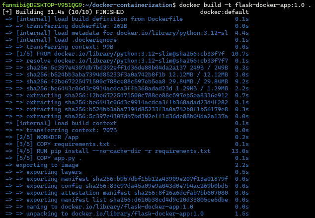
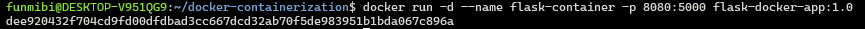
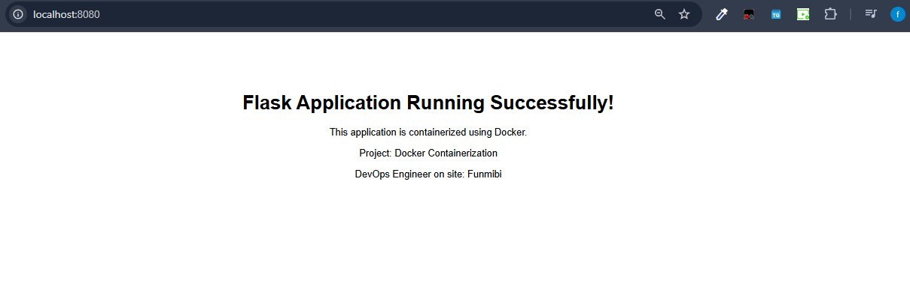

# Docker Containerization Project

## Overview
This project demonstrates how to containerize a Python Flask
web application using Docker.

## Technologies
- Python 3.12
- Flask
- Docker

## Build the Docker Image

```bash 
docker build -t flask-docker-app:1.0 .
```


### Run the Container

```bash
docker run -d --name flask-container -p 8080:5000 flask-docker-app:1.0
```




## Access the Application
Open `http://localhost:8080` in the browser.




## Optimization 
- Used a lightweight Python slip base image.
- Installed dependencies before copying application code.
- Used --no-cache-dir to avoid retaining pip's download cache.
- Added a .dockerignore file.


